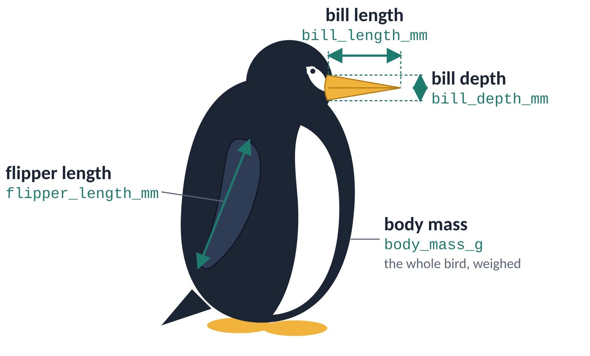

```{r}
#| include: false
# The site keeps data/ at its root; this page lives in module-11/.
library(tidyverse)
penguins <- read_csv("../data/penguins.csv", show_col_types = FALSE)
```

::: {.callout-note}
## How to use this page

- **Purpose:** practice the three ideas from class in more depth. Each
  exercise is a **pattern** for one task in Guided Project 11: solve it here
  on penguins, then repeat the same moves on your own data.
- **Task:** run the code in Posit Cloud: open `practice/practice_d1-d4.R`
  in the `module-11-aes` project (or download
  [practice_d1-d4.R](files/practice_d1-d4.R)) and work section by section.
  About 15 minutes per exercise.
- **Success:** you can answer each question **before** you open its answer,
  and your Modify and Make code draws the plot described.
- Predictions are not graded anywhere. Answers are here so you can check
  yourself: try first, then open them.
:::

What the measurement columns mean:

{fig-alt="Side view of a penguin facing right. Arrows mark bill length (along the top of the bill, base to tip), bill depth (top to bottom of the bill at its base) and flipper length (along the flipper); body mass is the weight of the whole bird. Each label shows its column name." width="70%"}

Every exercise starts the same way:

```{r}
#| eval: false
library(tidyverse)
penguins <- read_csv("data/penguins.csv")
```

| Exercise | Pattern | Guided Project task | Slides |
|---|---|---|---|
| [D1](#d1) | Explore a relationship: two numbers, a mapped group, a set `alpha` | A1, B1 | Session 1, 7–14 |
| [D2](#d2) | Amount per group: `count()` or `summarise()`, then `geom_col()` | A2, B2 | Session 1, 15–16 |
| [D3](#d3) | Change across time: `summarise()` by group and time, then `geom_line()` | B3 (A3 Credit Card only) | Session 1, 17–19 |
| [D4](#d4) | A summary layer on the raw data, with labels | A4, B4 | Session 2, 4–10 |

# D1 · Explore a relationship {#d1}

**Pattern:** two numeric columns on x and y; one categorical column mapped
to color (and shape); a fixed `alpha` when points overlap.

## Predict

Bill length and bill depth: when one goes up, does the other go up or down?
Will the answer change once each species gets its own color? Write your
prediction before running anything.

::: {.callout-tip collapse="true" title="Show answer"}
Look at the two plots below. Without color, the whole cloud tends to go
**down**: longer bills look shallower. With color, **within each species**
the points go **up**. The overall trend mixes three groups that sit in
different places. Mapping the group to color reveals it.
:::

## Run

```{r}
#| label: d1-run
ggplot(penguins, aes(x = bill_length_mm, y = bill_depth_mm)) +
  geom_point()

ggplot(penguins, aes(x = bill_length_mm, y = bill_depth_mm,
                     color = species, shape = species)) +
  geom_point()
```

## Investigate

1. What does one point stand for? What does the warning in the console
   say, and why?
2. Why map species to **both** color and shape?
3. You will set `alpha = 0.4` below. Why is alpha **set** (outside `aes()`)
   and not mapped?

::: {.callout-tip collapse="true" title="Show answers"}
1. One penguin. Rows with a missing bill length or depth have no position,
   so `geom_point()` removes them and says so in the warning.
2. Two cues for the same column: the plot still reads in grayscale and for
   readers who do not see color differences (color is never the only cue).
3. Transparency here is not information about each penguin; it is one
   design choice for all points so overlaps show. One value for every mark
   is a setting.
:::

## Modify

Map **shape to island** and **set** the transparency of every point to 0.4.
Predict first: how many legends will there be?

```{r}
#| eval: false
ggplot(penguins, aes(x = bill_length_mm, y = bill_depth_mm,
                     color = species, shape = ___)) +
  geom_point(alpha = ___)
```

::: {.callout-tip collapse="true" title="Show solution"}
```{r}
#| label: d1-modify
ggplot(penguins, aes(x = bill_length_mm, y = bill_depth_mm,
                     color = species, shape = island)) +
  geom_point(alpha = 0.4)
```
Two legends: one for color (species) and one for shape (island). Alpha has
no legend because it is set, not mapped.
:::

## Make (choose one)

- **Option A (Body size):** `flipper_length_mm` on x, `body_mass_g` on y,
  color mapped to `sex`.
- **Option B (Islands):** `body_mass_g` on x, `bill_depth_mm` on y, color
  mapped to `island`, alpha set to 0.5.

::: {.callout-tip collapse="true" title="Show solutions"}
```{r}
#| label: d1-make
ggplot(penguins, aes(x = flipper_length_mm, y = body_mass_g,
                     color = sex)) +
  geom_point()

ggplot(penguins, aes(x = body_mass_g, y = bill_depth_mm,
                     color = island)) +
  geom_point(alpha = 0.5)
```
Option A shows a third color for `NA`: penguins whose sex was not recorded.
That is real missing data; D4 Option B shows one way to drop those rows.
:::

::: {.callout-important}
## Pattern for Guided Project tasks A1 and B1

Choose two **numeric** columns of your dataset for x and y. Map one
**categorical** column (in Fairness Data: the outcome or a sensitive
attribute) to color. Your datasets have thousands of rows, so **set** alpha.
Write first: *each row of my data is one ___*.
:::

# D2 · Amount per group {#d2}

**Pattern:** make a small table with one row per group (`count()` or
`summarise()`), then draw it with `geom_col()`.

## Predict

`penguins %>% count(island)` makes a table. How many rows will it have, and
how many columns will the plot below have?

::: {.callout-tip collapse="true" title="Show answer"}
Three rows (Biscoe, Dream, Torgersen), so three columns: one mark per row.
:::

## Run

```{r}
#| label: d2-run
island_counts <- penguins %>% count(island)
island_counts
ggplot(island_counts, aes(x = island, y = n)) +
  geom_col()
```

## Investigate

1. True or false: `geom_col()` counts the rows for you.
2. Run `penguins %>% count(sex)`. Why are there three rows? What will the
   plot show for the third one?
3. `geom_col()` draws *any* number you computed, not only counts. Which
   function from Module 5 makes a table of means per group?

::: {.callout-tip collapse="true" title="Show answers"}
1. False. `count()` did the counting; `geom_col()` draws the heights you
   give it. (`geom_bar()` counts for you because it computes a statistic:
   Module 12.)
2. The third row is `NA`: penguins whose sex was not recorded. The plot
   shows a column labeled NA. Missing values are data too.
3. `group_by()` + `summarise()`.
:::

## Modify

Draw the number of penguins measured in each year.

```{r}
#| eval: false
year_counts <- penguins %>% count(___)
ggplot(year_counts, aes(x = year, y = ___)) +
  geom_col()
```

::: {.callout-tip collapse="true" title="Show solution"}
```{r}
#| label: d2-modify
year_counts <- penguins %>% count(year)
ggplot(year_counts, aes(x = year, y = n)) +
  geom_col()
```
:::

## Make (choose one)

- **Option A (Sexes):** count penguins by `sex` and draw the counts.
- **Option B (Means, not counts):** mean `body_mass_g` per species with
  `group_by()` + `summarise()`, drawn with `geom_col()`.

::: {.callout-tip collapse="true" title="Show solutions"}
```{r}
#| label: d2-make
sex_counts <- penguins %>% count(sex)
ggplot(sex_counts, aes(x = sex, y = n)) +
  geom_col()

species_mass <- penguins %>%
  group_by(species) %>%
  summarise(mean_mass = mean(body_mass_g, na.rm = TRUE))
ggplot(species_mass, aes(x = species, y = mean_mass)) +
  geom_col()
```
:::

::: {.callout-important}
## Pattern for Guided Project tasks A2 and B2

Pick one categorical column (an outcome, a sensitive attribute, a team, a
position…). `count()` it, then draw the counts with `geom_col()`. Before
plotting, print the small table: how many rows, so how many columns?
:::

# D3 · Change across time {#d3}

**Pattern:** `summarise()` one number per group and time point, then draw
one line per group with `geom_line()`.

## Predict

`penguin_means` below has one row per species and year. Will the first
plot show one line or three?

::: {.callout-tip collapse="true" title="Show answer"}
One line that zigzags: nothing tells ggplot2 the rows belong to three
species, so it joins all points in order of x and jumps up and down at each
year.
:::

## Run

```{r}
#| label: d3-run
penguin_means <- penguins %>%
  group_by(species, year) %>%
  summarise(mean_mass = mean(body_mass_g, na.rm = TRUE),
            .groups = "drop")
penguin_means
ggplot(penguin_means, aes(x = year, y = mean_mass)) +
  geom_line()
```

## Investigate

1. How many rows does `penguin_means` have? Why that number?
2. Run both plots below. Which geom follows the order of the rows, and which
   sorts by x first?

```{r}
#| label: d3-investigate
walk <- tibble(step = c(1, 3, 2), place = c(10, 30, 15))
ggplot(walk, aes(x = step, y = place)) + geom_line()
ggplot(walk, aes(x = step, y = place)) + geom_path()
```

3. The x axis shows values like 2007.5. Is that a problem with the data or
   with the axis?

::: {.callout-tip collapse="true" title="Show answers"}
1. Nine: 3 species × 3 years, one row per combination.
2. `geom_path()` follows the row order (1, 3, 2); `geom_line()` sorts by x
   (1, 2, 3). Minard's map is a path: the army's route, in order.
3. The axis: ggplot2 chose breaks for a continuous number. Changing breaks
   is part of scales (Module 13).
:::

## Modify

Give each species its own line.

```{r}
#| eval: false
ggplot(penguin_means, aes(x = year, y = mean_mass, color = ___)) +
  geom_line()
```

::: {.callout-tip collapse="true" title="Show solution"}
```{r}
#| label: d3-modify
ggplot(penguin_means, aes(x = year, y = mean_mass, color = species)) +
  geom_line()
```
A discrete mapping (color) also makes groups, so there is one line per
species. `group = species` would do the grouping without color.
:::

## Make (choose one)

- **Option A (Flippers):** mean `flipper_length_mm` per island and year,
  one line per island.
- **Option B (Counts over time):** `count(species, year)`, then one line per
  species showing how many penguins were measured each year.

::: {.callout-tip collapse="true" title="Show solutions"}
```{r}
#| label: d3-make
flipper_means <- penguins %>%
  group_by(island, year) %>%
  summarise(mean_flipper = mean(flipper_length_mm, na.rm = TRUE),
            .groups = "drop")
ggplot(flipper_means, aes(x = year, y = mean_flipper, color = island)) +
  geom_line()

species_year <- penguins %>% count(species, year)
ggplot(species_year, aes(x = year, y = n, color = species)) +
  geom_line()
```
:::

::: {.callout-important}
## Pattern for Guided Project task B3 (and A3 for Credit Card)

If your data has a time or order column (season, year, game number, round;
Credit Card: month), `summarise()` one number per group and time point,
then `geom_line()` with the group mapped to color. Check the number of rows
first: groups × time points.
:::

# D4 · A summary layer on the raw data {#d4}

**Pattern:** layer 1 shows every row; layer 2 brings its own small table
(one row per group) with its own `aes()`; layer 3 labels it.

## Predict

`species_centers` has columns `species`, `mean_flipper` and `mean_mass`.
The second layer below has no `aes()` of its own. Will it run?

::: {.callout-tip collapse="true" title="Show answer"}
No. `x` and `y` are set in `ggplot()`, so every layer inherits them. The
second layer looks for `flipper_length_mm` in `species_centers`, which does
not have it.
:::

## Run

```{r}
#| label: d4-run
#| error: true
species_centers <- penguins %>%
  group_by(species) %>%
  summarise(
    mean_flipper = mean(flipper_length_mm, na.rm = TRUE),
    mean_mass = mean(body_mass_g, na.rm = TRUE)
  )
species_centers
ggplot(penguins, aes(x = flipper_length_mm, y = body_mass_g)) +
  geom_point() +
  geom_point(data = species_centers, size = 5, shape = 4)
```

## Investigate

1. Read the error: which column is missing, and in which layer?
2. Fix it by giving the second layer its own `aes(x = …, y = …)`. Which
   columns go there?
3. In the plot below, `color = species` is in `ggplot()`. Are the X marks
   colored? Why?

```{r}
#| label: d4-investigate
ggplot(penguins, aes(x = flipper_length_mm, y = body_mass_g,
                     color = species)) +
  geom_point() +
  geom_point(data = species_centers,
             aes(x = mean_flipper, y = mean_mass),
             size = 5, shape = 4)
```

::: {.callout-tip collapse="true" title="Show answers"}
1. `flipper_length_mm`, in the 2nd layer.
2. `aes(x = mean_flipper, y = mean_mass)`: the columns of
   `species_centers`.
3. Yes. A mapping in `ggplot()` is **global**: every layer whose data has a
   `species` column uses it. Put `color = species` inside the first
   `geom_point()` to make it local to that layer.
:::

## Modify

Add a third layer that writes each species' name above its center.

```{r}
#| eval: false
ggplot(penguins, aes(x = flipper_length_mm, y = body_mass_g)) +
  geom_point(aes(color = species), alpha = 0.6) +
  geom_point(data = species_centers,
             aes(x = mean_flipper, y = mean_mass),
             size = 5, shape = 4) +
  geom_text(data = ___,
            aes(x = mean_flipper, y = mean_mass, label = ___),
            vjust = -1.2)
```

::: {.callout-tip collapse="true" title="Show solution"}
```{r}
#| label: d4-modify
ggplot(penguins, aes(x = flipper_length_mm, y = body_mass_g)) +
  geom_point(aes(color = species), alpha = 0.6) +
  geom_point(data = species_centers,
             aes(x = mean_flipper, y = mean_mass),
             size = 5, shape = 4) +
  geom_text(data = species_centers,
            aes(x = mean_flipper, y = mean_mass, label = species),
            vjust = -1.2)
```
:::

## Make (choose one)

- **Option A (Islands):** a scatter of `bill_length_mm` and `bill_depth_mm`
  colored by island, with each island's mean bill length and depth as a
  large X and its name as a label.
- **Option B (Sexes):** a scatter of `flipper_length_mm` and `body_mass_g`
  colored by sex, with a large X at the mean of each sex. Hint: drop the
  penguins with no recorded sex first, with `filter(!is.na(sex))`.

::: {.callout-tip collapse="true" title="Show solutions"}
```{r}
#| label: d4-make
island_centers <- penguins %>%
  group_by(island) %>%
  summarise(
    mean_length = mean(bill_length_mm, na.rm = TRUE),
    mean_depth = mean(bill_depth_mm, na.rm = TRUE)
  )
ggplot(penguins, aes(x = bill_length_mm, y = bill_depth_mm)) +
  geom_point(aes(color = island), alpha = 0.6) +
  geom_point(data = island_centers,
             aes(x = mean_length, y = mean_depth),
             size = 5, shape = 4) +
  geom_text(data = island_centers,
            aes(x = mean_length, y = mean_depth, label = island),
            vjust = -1.2)

penguins_sexed <- penguins %>% filter(!is.na(sex))
sex_centers <- penguins_sexed %>%
  group_by(sex) %>%
  summarise(
    mean_flipper = mean(flipper_length_mm, na.rm = TRUE),
    mean_mass = mean(body_mass_g, na.rm = TRUE)
  )
ggplot(penguins_sexed, aes(x = flipper_length_mm, y = body_mass_g)) +
  geom_point(aes(color = sex), alpha = 0.6) +
  geom_point(data = sex_centers,
             aes(x = mean_flipper, y = mean_mass),
             size = 5, shape = 4)
```
:::

::: {.callout-important}
## Pattern for Guided Project tasks A4 and B4

Layer 1: your scatter from A1/B1. Layer 2: a small table of group means
(`group_by()` + `summarise()`) with its **own** `aes()`. Layer 3:
`geom_text()` labels. In Fairness Data, check your dataset card first: a
group with fewer than 30 rows gives an unreliable mean. Say so in your
notes.
:::

---

*Data: Palmer Penguins (Horst, Hill & Gorman), CC0. Reference: Wickham,
Navarro & Pedersen, ggplot2 (3e), chapters 2, 3 and 13.*
